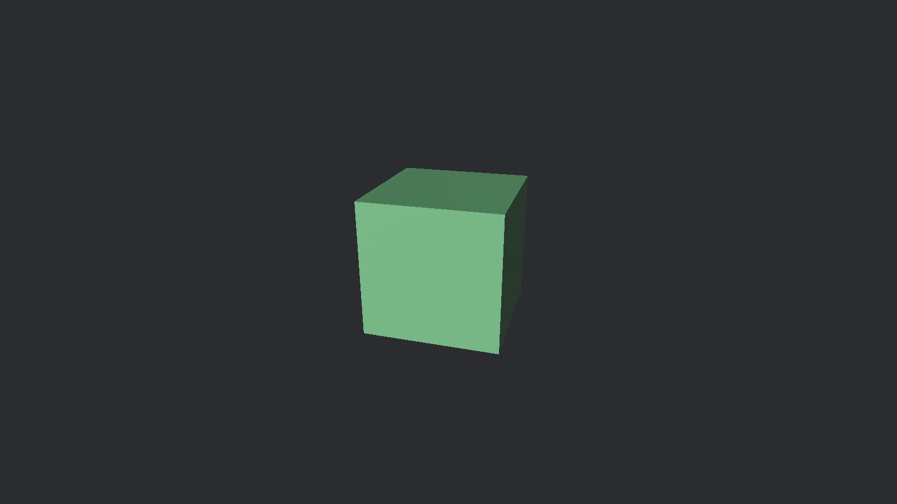

# Setting the scene



Before we can start working with voxels, we need a basic Bevy project.
Bevy makes breaking API changes approximately every three months, so follow the [quick start](https://bevy.org/learn/quick-start) to get your project up and running.
Make sure your Cargo configuration is set up correctly; you don't want to spend hours waiting for compilation.

Bevy uses _schedules_ to determine when systems run.
The most common schedules are `Startup`, `Update`, and `FixedUpdate`.

- `Startup` runs once when the app starts,
- `Update` runs every frame, and
- `FixedUpdate` runs at a fixed time interval, which is useful for things like physics.

Bevy also provides `Pre` and `Post` schedules for additional control, and plugins can introduce their own schedules too.
The order in which systems run can be a source of bugs, especially when systems depend on one another.
When your project gets more complicated, think carefully about the ordering of systems.

## Spawning the scene

We can't do much until we can look around and move through our world.
We'll start with a simple scene: a camera we can move, a predefined Bevy voxel, and a global light so we can actually see something.

The modern approach to spawning a scene in Bevy is to use [Bevy Scene Notation](https://taintedcoders.com/bevy/bsn).
Our scene is very simple, though, so you can also create a system for spawning each entity with `Commands::spawn`.
Whichever you choose, create a function for spawning the camera, the directional light, and the voxel.

### The camera

The camera entity needs `Camera3d` and `Transform` components.
Optionally, you can add a `Name` component for debugging.
Use the default camera component, but move the transform slightly up, back, and to the right so it isn't inside the voxel.
If you're unsure how to construct these components, use your IDE's autocompletion or consult the documentation.
To make the camera look at the voxel, we can use `Transform::looking_at`, so no rotational maths is required.
Also disable MSAA with `Msaa::Off`, because it can cause artifacts when sampling the voxel atlas.
If you want to understand the field of view, or other camera settings, you can adjust the perspective projection by adding a `Projection::Perspective` component.

### Global lighting

The directional light needs `DirectionalLight` and `Transform` components.
We use mostly the default directional light settings, but enable `shadow_maps_enabled` so we can see shadows.
Shadows are expensive, so it is best to aggressively limit the number of lights that cast shadows.
The position of the transform doesn't matter, but the rotation does.
To create a transform with a specific rotation, we can use `Transform::from_rotation`.
Rotations are represented as quaternions: four-dimensional vectors that can represent any rotation in 3D space.
Quaternions are hard to understand, but fortunately we can construct one from just the x, y, and z angles using `Quat::from_euler`.

### The voxel

We won't create our own voxel just yet.
First, we'll use a pre-defined Bevy voxel: a `Cuboid`.
It needs two components: a mesh and a material.
The mesh defines the shape of the voxel, and the material defines how the surface of that shape looks.
The mesh component, `Mesh3d`, contains a `Handle<Mesh>`: a reference to the actual mesh data.
This lets multiple entities share the same mesh or material.
The mesh data itself lives in _asset stores_, which we access by adding `mut meshes: ResMut<Assets<Mesh>>` as an argument.
We then add a `Cuboid` to the mesh asset store with `meshes.add`.
Adding a `MeshMaterial3d` works the same way, but we add a `StandardMaterial` to the material asset store instead.
The material itself is just a colour, created from RGB values with `Color::linear_rgb`.
Like most entities, the voxel also needs a `Transform`.

With all three systems in place, add them to the `Startup` schedule and run the app.
You should see a voxel in the middle of the screen.

## Cursor locking

When looking around, we don't want the cursor to leave the game window.
Before we implement looking, we need to lock the cursor to the window when we click inside it.
When the escape key is pressed, we want to unlock the cursor and show it again.

This system requires three arguments:

- `ButtonInput<KeyCode>` to check whether a certain key is pressed,
- `ButtonInput<MouseButton>` to check whether a mouse button is pressed, and
- `Single<&mut CursorOptions, With<PrimaryWindow>>` to access the cursor settings of the primary window.

`Single` lets us access a component on an entity when we expect exactly one matching entity in the game.
We use `With<PrimaryWindow>` to ensure that we only get the cursor settings for the primary window, even if the app has multiple windows.
To change the cursor's grab mode and visibility, we make the cursor options mutable.

If the user `just_pressed` the Escape key, we unlock the cursor and make it visible.
This is done by setting the cursor's `grab_mode` to `CursorGrabMode::None` and its `visible` field to `true`.
We do the inverse when the left mouse button is pressed: we lock the cursor (`CursorGrabMode::Locked`) and hide it.
We don't need to check whether the mouse is pressed inside the window, because Bevy doesn't capture inputs outside the game view anyway.

I wasn't sure whether there was a specific schedule for handling user input, so I googled (DuckDuckGo'd?) it.
Search assist confidently suggested: _You should use the `FixedUpdate` schedule for capturing and handling user input [...]_.
This is **wrong**!
The fixed-update schedule runs at a fixed interval and is used for things like physics.
Because it can run less frequently than the update schedule, it can miss input events.
This goes to show that you shouldn't blindly trust AI-generated answers.

In any case, there is no special schedule for input handling, so we can just add the system to the `Update` schedule.
`PreUpdate` can also make sense to separate collecting input from processing it.
You could even make your own schedule that sits between the two to further separate concerns and make your code more self-documenting.
Pick whichever you prefer.

## Looking around

Before we can start adjusting our position and rotation, we need to understand Bevy's [coordinate system](https://bevy-cheatbook.github.io/fundamentals/coords.html).
Bevy uses a right-handed coordinate system.
You can visualize the axes by holding out your right hand's thumb, index, and middle fingers perpendicular to each other.
The thumb points in the positive X direction, the index finger points in the positive Y direction, and the middle finger points in the positive Z direction.


Finally, we can create the system for looking around.
This system needs to know how much the mouse has moved so it can rotate the camera's transform accordingly.
Bevy provides an `AccumulatedMouseMotion` resource containing the mouse movement accumulated during the current frame.
We don't actually care about the camera itself, but rather its transform: `Single<&mut Transform, With<Camera3d>>`.

### Horizontal rotation

Hold out your right hand again and pretend it is the camera.
(Index finger pointing up and middle finger pointing towards yourself.)
Now, 'look' left and right with your hand.
You'll notice that your thumb (x) and middle finger (z) rotate, while your index finger (y) keeps pointing up.
Thus, if we want to look left and right, we need to rotate around the y-axis: `Transform::rotate_y`, using the accumulated mouse motion's horizontal (x) delta.

However, remember that the z-axis points towards yourself.
The camera looks forward, i.e. along the **negative** z-axis.
This means our direction of rotation is inverted, so we negate the mouse motion's delta before applying it to the camera's rotation.

Using the mouse delta directly rotates the camera much too quickly, so we need to scale it down by multiplying it by a constant, `MOUSE_SENSITIVITY`.

### Vertical rotation

Use the hand trick again to figure out which axis to rotate around when looking up and down.

If you run the game now, you'll notice that looking up and down can cause the camera to roll.
The problem is that we are rotating around the world's axes.
For horizontal rotation, this is not a problem because the player is always upright.
However, the player's horizontal orientation differs from the world's, so rotating around the world's horizontal axis can cause the camera to roll when looking up and down.
We want to rotate relative to the camera's orientation: `rotate_local`.

## Moving around

For the movement system, we again need the camera's transform.
This time, we need keyboard input rather than mouse input.

We check whether a key is pressed with `ButtonInput::pressed(KeyCode)`.
Because multiple keys can be pressed at the same time, we need to check all movement keys (W, A, S, D, Space, Shift) separately.
The easiest way is to define `mut movement: Vec3` and add a direction for every key that is pressed.
(It's possible to do this without any if-statements. Can you figure out how?)

```rust
if keyboard.pressed(KeyCode::KeyW) {
    movement += Vec3::Z;
}
```

Can you spot the mistake in the above code snippet?
If you use the hand trick again, you'll notice that your middle finger (z) points towards yourself (back).
When we press W, we want to move forward, i.e. away from ourselves.
Thus, we need to subtract the z-axis rather than add it.

> Remember the hand trick! It comes in handy often.

Modify `movement` for the other keys as well.
Then, we can update the camera's position by adding the movement delta to the camera's translation.

```rust
camera.translation += movement;
```

If you try this out, you might notice several issues.

- The camera moves too slowly and at an inconsistent speed.
- Movement is not relative to the camera's rotation.

### Movement speed

Like with looking, using the raw input for movement is likely too slow or too fast.
Again, we'll simply define a constant `MOVE_SPEED` and multiply the movement delta by it.

The movement input is a three-element vector.
Each element is either $1$, $0$, or $-1$, depending on which movement keys are pressed.
For example, $(1, 0, 0)$ when moving right or $(0, 1, 0)$ when moving up.
If we move both right and up, the movement delta will be $(1, 1, 0)$.
As a result, the camera moves $\sqrt{2}$ times faster diagonally.

The solution is simple: we _normalize_ the input.
Normalizing a vector means that the length of the vector is scaled to 1, keeping the ratio between elements.
For example, $(0.5, 0, 0)$ and $(3.7, 0, 0)$ both normalize to $(1, 0, 0)$.
$(2, 2, 1)$ normalizes to $(\frac{2}{3}, \frac{2}{3}, \frac{1}{3})$: the first two elements are equal, and the third is half of that, but the total length of the vector is now 1.
Normalization is not possible for the zero vector, so either check if `movement != Vec3::ZERO` or use `normalize_or_zero`.

There's one more subtle issue: movement speed depends on the frame rate.
You might have seen this behaviour in other games, especially ones that were designed for older consoles.

A game that comes to mind is GTA San Andreas.
If you run the desktop version with an uncapped frame rate, weird things start to happen.
You'll swim much slower, mission timers count down much faster, and cars will start to 'dance'.
Many games from that era were specifically designed for consoles, where they would typically run at a predictable frame rate.
Desktop hardware is much more variable, though, so tying systems to the frame rate can cause weird behaviour.

We solve this by scaling time-dependent systems according to the time elapsed since the previous frame.
If we move 10 units per second, and we have 5 frames per second, that means for each of those frames we should move $10 / 5 = 2$ units.
If in the next second our frame rate increases to 20 FPS, we should move $10 / 20 = 0.5$ units per frame.

> Alternatively, this is where the `FixedUpdate` schedule comes into play. It runs at a fixed time interval, typically slower than the frame rate, and is often used for time-dependent, compute-intensive systems like physics.

In Bevy, the time elapsed since the previous frame is stored in the `Time` resource.
We access it with `Time::delta_secs()`, which we multiply with the movement delta to make it independent of the frame rate.

### Relative movement

Moving forward always moves the camera along the world's z-axis, regardless of which way the camera is looking.
Similarly to looking, we want to move relative to the camera's orientation.

`Vec3::X` and `Vec3::Z` are the world's axes, but how do we modify these to move relative to the camera's rotation instead?
When the player is rotated exactly 90 degrees to the right, moving forward ($-z$) means moving along the world's x-axis: $(0, 0, -1)$ becomes $(1, 0, 0)$.
If the player is rotated halfway, by 45 degrees, the direction becomes a combination: $(\frac{\sqrt{2}}{2}, 0, \frac{\sqrt{2}}{2})$.
Crucially, the direction is a vector rather than a single axis.

Luckily, we don't need to do any of this maths ourselves.
We use `Transform::forward` to get the camera's forward-facing vector in world space.
So instead of moving along `Vec3::X` and `Vec3::Z`, we move along `Transform::right` and `Transform::forward`.

The player is always upright, so moving up and down should not depend on the rotation of the camera.
(If we are looking straight down, pressing space should still move us up, not forward.)
We leave the vertical movement unchanged.

## Run conditions

At this point, we can look around and move through the scene.
However, we shouldn't do either when the game window isn't focused.

One way to handle this is to check at the start of the relevant systems whether the cursor is locked, returning early if it isn't.

```rust
fn is_focused(cursor: Single<&CursorOptions, With<PrimaryWindow>>) -> bool {
    cursor.grab_mode == CursorGrabMode::Locked
}
```

Bevy provides a cleaner solution: [run conditions](https://bevy-cheatbook.github.io/programming/run-conditions.html).
When adding the systems, we can attach a condition that determines whether they should run using `(a, b).run_if(is_focused)`.
Bevy then runs systems _a_ and _b_ only when the condition is satisfied, keeping their logic separate from the question of whether they should execute.

## Fallible systems

Another useful feature are fallible systems.
Systems can return a result, which makes those systems ergonomic to code with [`context`](https://bevy.org/news/bevy-0-20/#bevy-error-context-messages) and the `?` operator, and allows Bevy to handle errors gracefully.
