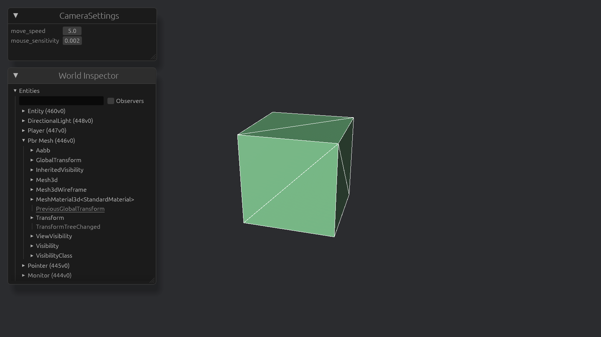

# Inspecting settings



In the previous chapter, we used constants for the camera's movement speed and mouse sensitivity.
Want to change either value, then you have to edit the code and recompile.
It would be much nicer to tune them while the game is running.

We can do that with [egui](https://github.com/taboky-dev/bevy-inspector-egui), which lets us inspect and edit values through a GUI.
Add [bevy-inspector-egui](https://crates.io/crates/bevy-inspector-egui) as a dependency and make sure the app adds the `EguiPlugin`.

## Replacing constants with a resource

Constants aren't meant to change at runtime, so let's replace them with a `CameraSettings` struct.
It will hold the movement speed and mouse sensitivity.
You can implement the `Default` trait, or derive it with the [better_default](https://crates.io/crates/better_default) crate.
I prefer the latter because the default values stay close to the struct definition.

Our systems need access to these settings, so make `CameraSettings` a Bevy resource by deriving `Resource` and register it with the app using `init_resource::<CameraSettings>()`.
(`init_resource` requires that the type implements `Default` or `FromWorld`. If you don't want that, you can use `insert_resource` instead.)
Then, update the look and move systems to use the resource instead of the constants.
Remember to add the resource as an argument to the functions.

## Inspecting resources

To browse entities, resources, and assets in our game we add the `WorldInspectorPlugin` to the app.
If you start the game, a GUI appears in the top left that lists all entities, resources and assets.

However, there is no `CameraSettings` in the list of resources.
The inspector first needs information about a type so it can display and edit its values.
In Bevy, that information comes from [reflection](https://docs.rs/bevy_reflect).
Reflection enables inspection and manipulation of values without knowing their concrete types at compile time.
To make `CameraSettings` available to the inspector, derive `Reflect` and add `#[reflect(Resource)]` to the struct.
Then register the type with the app using `register_type::<CameraSettings>()`.

Now, the camera settings appear in the inspector, and we can adjust them while the game is running.
Note that these changes are lost when the game closes.
If you want to keep your adjustments, remember them and update the default values in the code.
(You could save and load settings through (de)serialization, but at this point that is not yet worth the effort. We'll discuss serialization and deserialization later for storing the world.)

The inspector currently lets us enter arbitrary values, which can cause problems.
For example, a negative movement speed reverses the direction of movement.
We can constrain the values with `InspectorOptions`.
Add `InspectorOptions` to both `#[derive()]` and `#[reflect()]`.
Then, you can specify bounds for each field with:

```rust
#[inspector(min = 0.1, max = 20.0)]
move_speed: f32,
```

The world inspector is useful, but it can be overwhelming when all we want to change is the camera settings.
Instead of using `WorldInspectorPlugin`, you could use `ResourceInspectorPlugin::<CameraSettings>`.
That gives us a dedicated window for editing only that resource.

## Cursor grabbing

There's one problem: when we click on the inspector, the game grabs the cursor.
We need to stop `toggle_cursor` from capturing the mouse when the click is meant for the GUI.

A quick search leads us to [`EguiWantsInput`](https://docs.rs/bevy_egui/latest/bevy_egui/input/struct.EguiWantsInput.html).
Read the documentation to see how egui signals that it wants keyboard or pointer input.
Then, in `toggle_cursor`, only grab the cursor if egui does not want the input.
