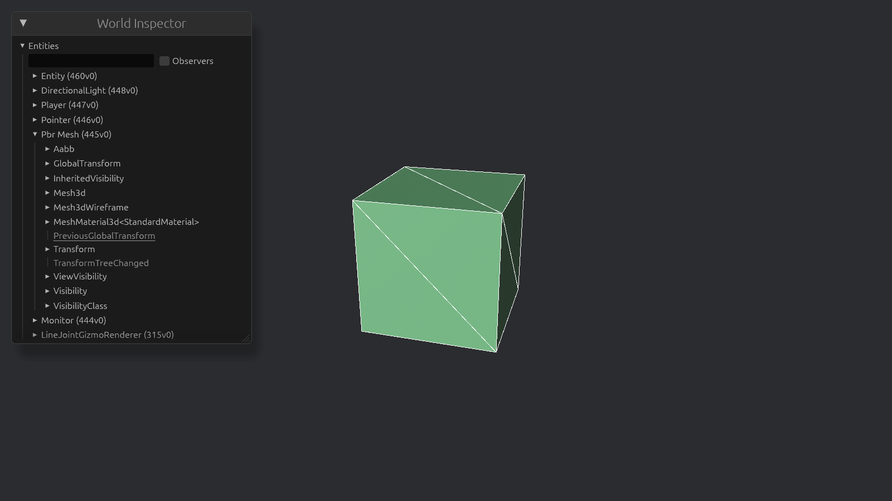

# The first mesh



I hope you're warmed up, because this is where the real work starts.
In this chapter we are going to manually generate the mesh for a voxel, rather than using Bevy's built-in `Cuboid` primitive.
In a real voxel game, we don't want to create a separate cuboid for every voxel.
Instead, we want to combine the visible faces of many voxels into a single mesh for each chunk.

When our game has hundreds, or even thousand of voxels, we don't want to spawn a cuboid for every single voxel.
First, this would mean that we generate a lot of faces for voxels that we can't even see.
Second, graphics cards are not optimized for rendering on many small meshes, scattered throughout memory.
They are much better at operating on large, contiguous blocks of data, which is why we want to combine many voxels into a single mesh.
This groups the different data of each voxel by type ([AoS2SoA](https://en.wikipedia.org/wiki/AoS_and_SoA)), and puts them next to each other in memory ([batching](https://en.wikipedia.org/wiki/Batch_processing)), which is much more efficient for the GPU to process.

## Visualizing meshes

We can visualize the so-called _wireframe_ of a mesh by drawing lines between the vertices of each triangle.
In Bevy, we can do this by adding the `WireframePlugin` to our app.
Then, we insert the configuration globally for all meshes:

```rust
WireframeConfig {
    global: true,
    ..default()
}
```

Run the game, and see what the mesh looks like.
Use the inspector to adjust the scale of the cube, and observe how the wireframe changes.
Then, replace the cube with a `Sphere`, or some other shape, and see how the wireframe looks for that shape.

## But what even is a mesh?


Essentially, a mesh just defines the shape of a 3D object.
This shape is broken up into polygons (triangles), that together form the surface of the shape.
We use triangles because they are the simplest 2D shape, making them the easiest to work and compute with.

In its simplest form, a mesh consists of a list of _vertices_ and a list of _indices_.
The vertices define the corners of the triangles in the mesh.
Each 3-tuple in the list of indices tells which three vertices form a triangle.

To make a triangle, we need three vertices and three indices.
The triangle is then formed by connecting the three vertices in the order specified by the indices.
Say, we have the following vertices: $v_0 = (0, 0)$, $v_1 = (1, 0)$, and $v_2 = (0, 1)$.

```text
| v2
|
|
| v0   v1
+—————————
```

If the indices are `[0, 2, 1]`, then the triangle is formed by connecting $v_0$ to $v_2$, $v_2$ to $v_1$, and $v_1$ back to $v_0$.

```text
| v2            | v2            | v2
|  |            |  | \          |  | \
|  |            |  |  \         |  |  \
| v0   v1       | v0   v1       | v0———v1
+—————————      +—————————      +—————————
```

A square has four corners, but because we can only make triangles, we need to split it into two triangles, resulting in $2 \times 3 = 6$ indices.
However, these two triangles share two vertices, meaning we only need four vertices.
In the previous example, that would mean adding a fourth vertex $v_3 = (1, 1)$ and extending the indices to `[0, 2, 1, 1, 2, 3]`.

### Winding order

The order in which we create a triangle matters.
In the previous example, we created a triangle in a clockwise order.
In a counter-clockwise order, the indices would be `[0, 1, 2]`.

This distinction matters: we typically only render one side of a triangle.
We normally don't see the inside of a mesh anyway, so why would we bother rendering both sides.
However, that means we need to be careful about the order in which we create triangles, or some of them might seem invisible.
(Using the wireframe view can help you find these kinds of errors.)

By default, Bevy uses a [counter-clockwise](https://docs.rs/bevy/latest/bevy/mesh/struct.Mesh.html) winding order.
That means the example from before would be invisible, because the triangle is facing the wrong way.
Instead, we should create the square from the indices `[0, 1, 2, 2, 1, 3]`.

### Combining faces into a cube

To create a cube, we need to combine six square faces.
Just like how we reused two vertices for making a face, you might think we can also reuse each vertex across its three adjacent faces.
However, a vertex contains more data than just its position.
Another attribute that is relevant now are _normals_.

The normal of a vertex is a vector that points perpendicular to the surface of the mesh at that vertex.
It describes which way the surface is facing, which is used for lighting calculations to determine how light interacts with the surface.

In the case of a cube, each normal points along one of the axes.
That is, the four normals of the right face point along positive x: $(1, 0, 0)$.
If we were to use the same vertex for three adjacent faces, averaging the normals, the normal would point diagonally outward, resulting in a smooth shading across the cube's edges.
To avoid this, we have to give each face its own set of normals, which gives the cube its sharp edges.

### Texture coordinates

For the same reasons we want to bundle voxels together into one big mesh, we often also want to combine multiple smaller textures into a single image.


But of course, we don't want every face to show the entire image.
Instead, we need some way to select a specific region of the texture for different parts of the mesh.
For example, for a stone voxel we only want to use the top-left quarter of the texture rather than the whole thing.

This is what UV coordinates are for: they assign each vertex a position in the texture.
Each UV coordinate is a 2D vector with values between zero and one.
$(0, 0)$ is the top left corner of the texture, $(1, 0)$ the top right, and $(1, 1)$ the bottom right.
In the image below, that corresponds to cyan, orange, and orange, respectively.


Then, when we render a triangle, for each pixel in the triangle, we interpolate the UV coordinates of its three vertices to find the corresponding pixel in the texture.
A pixel a third of the way between vertices $v_0$ and $v_1$ would thus use a weighted average of their corresponding UV coordinates: $\frac{2}{3}v_0(uv) + \frac{1}{3}v_1(uv)$.
In the above gradient, that would be a yellow-ish colour.
We repeat this process for every pixel in the triangle, until the whole surface is coloured.

```text
  (0, 0) +———————————————+ (1, 0)
         | Stone | Dirt  |
         |       |       |
(0, 0.5) |———————+———————| (1, 0.5)
         | Wood  | Log   |
         |       |       |
  (0, 1) +———————————————+ (1, 1)
```

> You might have noticed that the [y-axis points downwards](https://bevy-cheatbook.github.io/pitfalls/uv-coordinates.html) in the image. This is inconsistent with Bevy's coordinate system, where the y-axis points up. It is, however, consistent with how most image file formats store pixel data, and with how most graphics APIs work:

Our voxel has six faces, each consisting of two triangles.
This gives our voxel a total of $6 \times 4 = 24$ vertices, $6 \times 2 \times 3 = 36$ indices, $6 \times 4 = 24$ normals, and $6 \times 4 = 24$ UV coordinates.

## Building the mesh

We now have everything we need to generate our first mesh:

- _Positions_ describe where the vertices are.
- _Indices_ describe which vertices form each triangle.
- _Normals_ describe which way the surface faces for lighting.
- _UV coordinates_ describe how a texture maps onto the surface.

We'll work backwards in constructing the mesh: we won't know what to make before we know what Bevy expects.
We already know from the previous chapters that we need a `Mesh3d` and `MeshMaterial3d` component to render a mesh.
We leave the material a solid colour for now.
Thus, we need to figure out what to put in the asset store in place of the `Cuboid`.

If we look up [the documentation](https://docs.rs/bevy/latest/bevy/prelude/struct.Mesh.html) for `Mesh`, there is immediately a subsection _manual creation_ at the top.
We see the four core components that we discussed before:

- `Mesh::ATTRIBUTE_POSITION` sets the vertices,
- `Mesh::ATTRIBUTE_NORMAL`, sets the normals,
- `Mesh::ATTRIBUTE_UV_0`, sets the UV coordinates, and
- `Indices::U32` sets the indices.

`PrimitiveTopology` tells the renderer how to treat the vertex data.
Most of the time this will be `PrimitiveTopology::TriangleList`.
`RenderAssetUsages` tells whether the asset should be kept in memory after it has been uploaded to the GPU.
Because we know that, in future, our mesh will change when we build or destroy blocks, we want to keep it in memory, so we use the default value.
If the mesh is unchanging, we would use `RenderAssetUsages::RENDER_WORLD` instead to save memory.

We can copy-paste this as a starting point for our voxel mesh.

```rust
fn build_mesh() -> Mesh {
    let mut vertices: Vec<Vec3> = Vec::with_capacity(6 * 4);   // 4 vertices per face
    let mut indices: Vec<u32> = Vec::with_capacity(6 * 2 * 3); // 2 triangles per face
    let mut normals: Vec<Vec3> = Vec::with_capacity(6 * 4);    // 4 normals per face
    let mut uvs: Vec<Vec2> = Vec::with_capacity(6 * 4);        // 4 uvs per face

    todo!();

    Mesh::new(PrimitiveTopology::TriangleList, RenderAssetUsages::default())
        .with_inserted_attribute(Mesh::ATTRIBUTE_POSITION, vertices)
        .with_inserted_attribute(Mesh::ATTRIBUTE_NORMAL, normals)
        .with_inserted_attribute(Mesh::ATTRIBUTE_UV_0, uvs)
        .with_inserted_indices(Indices::U32(indices))
}
```

Each face has its own set of vertices, normals, and UV coordinates, so we can process the six faces independently.

For convenience, we can define a `Face` struct.
It only needs to contain the direction that this face is pointing.
A `Vec3` would be enough, but I like to create separate types for different concepts, so the compiler won't allow us to mix them up by accident.

```rust
enum Direction {
    /// Increasing x
    Right,
    /// Decreasing x
    Left,
    /// Increasing y
    Top,
    /// Decreasing y
    Bottom,
    /// Increasing z
    Front,
    /// Decreasing z
    Back,
}
```

Then, for each direction we create a face in `build_mesh`.
Assuming `Face` has four functions for generating the vertices, indices, normals, and UV coordinates, we can extend the corresponding vectors with the data for each face using `extend` (e.g. `vertices.extend(&face.get_vertices())`).
Now it comes down to implementing those four functions.

Remember that a face consists of two triangles, for a total of four vertices and six indices.

### Indices

We actually start with the indices, because the first thing we need to determine is in which order we store the vertices.
Looking from outside the face, I have chosen to add the vertices in the following order: bottom left, bottom right, top left, and top right.
It doesn't matter which order you choose, as long as you are consistent across all faces.
Otherwise, you'll get a very weird-looking voxel.

```text
2————3
|    |
|    |
0————1
```

For constructing the two triangles we again have multiple options.
We could 'cut' the square from top left to bottom right, or from bottom left to top right.
I've chosen the latter:

```text
2————3
| \  |
|  \ |
0————1
```

So we now have two triangles, consisting of the vertices `0, 1, 2` and `1, 2, 3`.
But, remember that the order of the vertices matters: we need to make sure that vertices are added in a counter-clockwise order.
For the first triangle, `0, 1, 2` is already correct, for the second triangle we order the vertices as `2, 1, 3`.

But wait!

What if this is the second face we are adding to the mesh?
Then, `0, 1, 2, 3` correspond to the indices of the vertices that were added by the previous face.
Thus, we need to offset the indices by the number of vertices that were already present in the mesh before we started with the current face.
Compute this in `build_mesh`, and pass it into this function as an argument.

### Vertices

We already determined the order of the vertices, so now we need to figure out where in 3D space the four vertices of this face are located.
Here, we can't really do better than a case distinction for each direction.

Let's start with just the right face now, after which you should be able to do the rest.

```rust
match self.direction {
    Direction::Right => [
        todo!(), // Bottom left  (v0)
        todo!(), // Bottom right (v1)
        todo!(), // Top left     (v2)
        todo!(), // Top right    (v3)
    ],
    _ => [Vec3::ZERO; 4],
}
```

Doing this without any visual aid is a bit tricky, so I recommend drawing a 3D cube on a piece of paper.
In the example below I've only filled in the origin.
Note that it sits in the back, because the z-axis increases towards the front.
Fill in all remaining $x$, $y$, and $z$ coordinates with either $0$ or $1$.

```text
    (x,y,z)———————————————————(x,y,z)
         /|                  /|
        / |                 / |
       /  |                /  |
(x,y,z)—————————————(x,y,z)   |
      |   |               |   |
      |   |               |   |
      |   |               |   |
      |  (0,0,0)——————————|——(x,y,z)
      | /                 | /
      |/                  |/
(x,y,z)———————————————————(x,y,z)
```

Then, visualize this cube as if you are looking at it from the right side.
From that point of view, the order of the vertices should be:

```text
          +———————————————————v3
         /|                  /|
        / |                 / |
       /  |                /  |
      +———————————————————v2  |
      |   |               |   |
      |   |               |   |
      |   |               |   |
      |  /————————————————|——v1
      | /                 | /
      |/                  |/
      +———————————————————v0
```

From here, you should be able to match $v_0$ through $v_3$ to the corresponding coordinates you found in the cube, putting them in place of the `todo`s.
Repeat this process for the five other faces.

### Normals

Normals are the easiest, because they are the same for all four vertices of a face.
(Remember that this is what gives the cube its sharp edges.)
The normal for each face is simply the direction of the face.
For example, for `Direction::Right`, the normal is `Vec3::X` ($(1, 0, 0)$).
Determine the normal for the given direction, and then return an array `[Vec3; 4]` with that normal repeated four times.

### UV coordinates

Because the material is a solid colour, the UV coordinates don't matter for now.
Nonetheless, for completeness we'll set the UV coordinates to the entire texture.
Remember that we added the four vertices of the face in the order: bottom left, bottom right, top left, and top right, looking at the face from the outside.

Thus, the first vertex should have UV coordinates at the bottom left of the texture.
But, remember that the y-axis is flipped in UV coordinates, so the bottom left voxel actually has $y = 1$ in UV coordinates.
Because you can't visually see whether what you've done is correct, I'll just give you the UV coordinates for the four vertices, in order: $(0, 1)$, $(1, 1)$, $(0, 0)$, and $(1, 0)$.

> Your voxel not quite looking like a voxel? Remember to enable the wireframe view to help you debug the mesh. Pay particular attention to the list of indices, as this is the most common source of errors. When in doubt, apply your code on paper to visually verify that the triangles are formed correctly.

That's it, you should now have your own, homemade voxel mesh!
