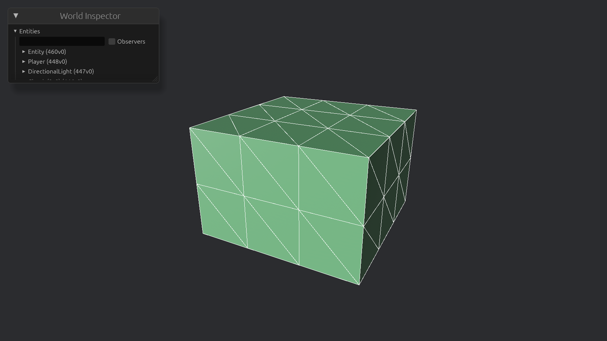

# Creating a chunk



The whole point of creating our own mesh was to more efficiently generate chunks, so let's do that, shall we?
Chunks are at the core of our game, so it's worth first thinking carefully about how we represent our data.

Our first instinct might be to represent each voxel as a struct containing everything associated with it:

- Its position and orientation.
- References to neighbouring voxels.
- Its inventory or other attached data.
- Its type and other properties.

This can work, but it also means storing a lot of information that we don't necessarily need.
Imagine a world containing millions of voxels.
If every voxel stores its own position, we duplicate information that we could derive from its location in the chunk.
If every voxel stores references to its neighbours, we add more data and make changes to the world more complicated.

Every byte of extra data blows up when we have millions of voxels, so we need to be extremely careful about what we store, and where.

I wouldn't be surprised more complicated voxels, like chests or furnaces, will ultimately become entities.
We are working with an Entity Component System, after all.
I'll leave that to a future chapter.

## What's in a chunk?

All a chunk needs to know is what voxels it has, and where.
The _what_ is easy: we can create a `VoxelType` enum, that contains only the type of voxel and nothing else.

```rust
enum VoxelType {
    Air,
    Grass,
}
```

The _where_ is not so straightforward.
We can't waste space storing the voxel's position, but luckily we don't need to: based on the index of a voxel in the chunk's voxel array, we can derive its 3D coordinate within the chunk.

We have two options for storing the voxels:

- A 3D array: `[[[VoxelType; CHUNK_WIDTH]; CHUNK_HEIGHT]; CHUNK_WIDTH]`
- A flat array: `[VoxelType; CHUNK_WIDTH * CHUNK_HEIGHT * CHUNK_WIDTH]`

Both have their advantages and disadvantages.
From what I could find, it seems that they _should_ have the same memory layout.
A 3D array is easier to index, but the flat array is simpler to iterate over. (_Need to look more into this._)
Pick whichever you prefer.

To index into the flattened array from an x, y, and z coordinate, we use this formula:

> `index = x + CHUNK_WIDTH * (y + CHUNK_HEIGHT * z)`

- Moving along x simply increments the index.
- Moving along y means we 'move by a row', which means moving by `CHUNK_WIDTH` entries.
- Moving along z means we 'move by a layer', which means moving by `CHUNK_WIDTH * CHUNK_HEIGHT` entries.

Keep this in mind if you ever iterate over large areas of the chunk.
It is best to put the z loop on the outside, the y loop in the middle, and the x loop on the inside.
Incrementing x by one (y and z remaining the same) is the next entry in memory, which is likely already loaded into the processor's caches.
Putting the loops in the opposite order leads to a lot of jumping around in memory: incrementing z by one (x and y remaining the same), we jump by `CHUNK_WIDTH * CHUNK_HEIGHT` entries every time.

> This results in so-called [_cache misses_](https://www.geeksforgeeks.org/computer-organization-architecture/types-of-cache-misses), and inhibits the use of [_vectorization_](https://en.wikipedia.org/wiki/Single_instruction,_multiple_data).

To determine whether a face should be shown, we need to be able to check the neighbouring voxel in that face's direction.
That is, to determine if we should show the top face of a voxel, we check whether the voxel above it is air.

Add a function for this to `chunk`.
It should receive the coordinates of the voxel, and the direction to check.
From these inputs, determine the coordinates of the neighbouring voxel.
For voxels on the edge of the chunk, the neighbour might not exist, so return an `Option<VoxelType>`.

## Spawning the chunk

Instead of a voxel, we now spawn a chunk.
The chunk is then responsible for rendering its chunks.
Rather than filling the chunk entirely with either air or grass, create some pattern to make it more interesting.

Then, we spawn the mesh.
Keep the transform at the origin and leave the material unchanged.
The only difference is the mesh; create a new function for generating a mesh from a chunk, and pass it the created chunk data.

We use the same basic template as in the previous chapter for building the mesh, but here we use `Vec::new` instead of `with_capacity`, because we won't know beforehand how large the mesh will be.

```rust
fn build_mesh(chunk: &ChunkData) -> Mesh {
    let mut vertices: Vec<Vec3> = Vec::new();
    let mut indices: Vec<u32> = Vec::new();
    let mut normals: Vec<Vec3> = Vec::new();
    let mut uvs: Vec<Vec2> = Vec::new();

    Mesh::new(PrimitiveTopology::TriangleList, RenderAssetUsages::default())
        .with_inserted_attribute(Mesh::ATTRIBUTE_POSITION, vertices)
        .with_inserted_attribute(Mesh::ATTRIBUTE_NORMAL, normals)
        .with_inserted_attribute(Mesh::ATTRIBUTE_UV_0, uvs)
        .with_inserted_indices(Indices::U32(indices))
}
```

## Generating the mesh

We build the mesh voxel-by-voxel, so start by iterating over every voxel in the chunk.
If that voxel is air, we don't need to render anything and skip it.
Otherwise, we have a solid voxel and might need to generate its faces, if any are visible.

For each direction, get the neighbouring voxel.
If there is no neighbouring voxel, or it is air, we need to render that face.

Most of the rendering is actually the same as it was in the previous chapter.
There is only one difference: the singular voxel was assumed to always be at the origin, but now we need to offset the face vertices by the voxel's coordinates.
Otherwise, we would put all voxels at $(0, 0, 0)$.

We already have the x, y, and z coordinates of the current voxel, so we can modify the vertex function by offsetting the generated vertices by the voxel's position.

Run the game and inspect the chunk.
If you move the camera inside the chunk, you should see that the interior is hollow.

## Refactoring meshes

In future, we'll be creating a mesh for each chunk.
For this, it can be convenient to group vertices, indices, normals, and uvs into a single `MeshData` struct.
That keeps the relevant data in one place, and we can add some convenience functions, like `add_quad`.
If you want, extract the mesh data into a separate struct now.

Now might also be a good time to get rid of the `Face` struct.
It was useful for generating a single cube, but now that we're generating many faces, it adds unnecessary complexity.
Its logic can be moved into the `MeshData` instead.
If you put the `MeshData` in a separate file, you can more easily determine which parts are specific to rendering, and should be there.

---

- [How do I efficiently store blocks in chunks?](https://www.reddit.com/r/VoxelGameDev/comments/1lynvrl/how_do_i_efficiently_store_blocks_in_chunks/)
- [Storing voxels for a voxel engine in C](https://gamedev.stackexchange.com/questions/172119/storing-voxels-for-a-voxel-engine-in-c)
- [Designing a voxel structure around ECS](https://discussions.unity.com/t/designing-a-voxel-structure-around-ecs/789222/4)
