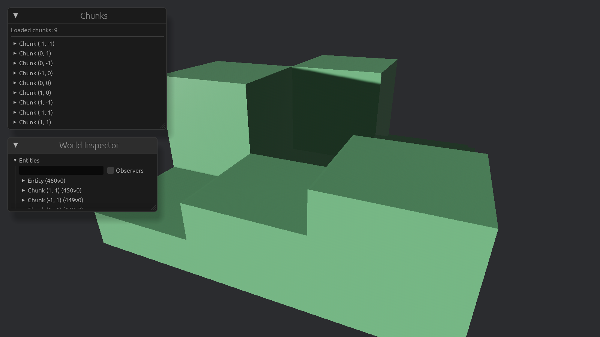

# Multiple chunks



It's time to start growing the world beyond a single chunk.
In this chapter we'll start creating a `VoxelWorld` resource that keeps track of all chunks in the world.
(Don't name it `World`; Bevy already uses that name.)

## Storing the world

Initially, I assumed a `HashMap` would be the best approach for storing chunks, but I still took a moment to look at the alternatives.
Bevy provides its own [hash map implementation](https://docs.rs/bevy/latest/bevy/platform/collections/hash_map/index.html), intended for use in game engines, so I'll use that rather than importing one from the standard library.

The `VoxelWorld` resource stores chunks in a map, keyed by their position.
Each position contains an x and z coordinate.
We don't need a y coordinate because chunks extend through the entire height of the world and are only placed horizontally.
If you want, you can choose to also grow the world vertically, it does not significantly change much.
It might be worthwhile to create a dedicated struct for this, to avoid conflating it with a voxel's local position, or a global world position.

The chunk's coordinate is different from its position in world space.
For a chunk at coordinate $(x, z)$, its world-space origin is $(x \times CHUNK_WIDTH, 0, z \times CHUNK_WIDTH)$.

Keep in mind that, when we generate a chunk's mesh, we put the mesh at the position of the chunk.
That means the mesh's vertices are relative to the chunk's position.
This is important, because it means the mesh does not need to know about the chunk's coordinates: the mesh's origin is still at $(0, 0, 0)$ locally.

## Spawning some chunks

We'll start with a fixed-size world of nine chunks, arranged in a $3 \times 3$ grid.
When generating the chunk data, make the terrain height vary based on the chunk's coordinates, so we can check if faces at chunk boundaries are generated correctly.

Previously, we bundled chunk generation and mesh generation together.
Now, we have to separate them.
When we generate the mesh of a chunk, we might need to check whether a voxel in a neighbouring chunk is solid to determine whether to generate a face at the chunk boundary.
Thus, the chunk spawn function now contains two loops: one to generate the chunk data (the array of voxel types), and another to generate the mesh.

> When we start generating chunks dynamically, we'll need a more deliberate strategy for handling chunks that are not ready yet. Throughout chapters, we'll incrementally make improve the strategy.

## Adjusting the mesh generation

When checking a neighbouring voxel, to determine if we should draw the face, there are two cases:

- The neighbour is inside the current chunk; we can inspect it directly.
- The neighbour is outside the current chunk; we check whether a neighbouring chunk exists and, if it does, inspect the voxel on its corresponding edge.

The first case is unchanged from before.
For the second case, we need to consider multiple steps.

What is the direction of the face?
For the top and bottom faces (assuming chunks only extend horizontally), do we need to show the faces at chunk boundaries?
This depends on the type of game you are making.
I've chosen to always show those faces.

Does the neighbouring chunk exist?
If not, always show the face.
Later, when we further improve the algorithm, this won't a consideration any more.

If the neighbouring chunk exists, we need to determine the coordinate of the neighbouring voxel from that chunk.
This depends on the direction of the face.
If we are comparing against a chunk on the left or right (x-axis), the neighbouring voxel's y and z coordinates remain the same, but the x coordinate is either 0 or `CHUNK_WIDTH - 1`.

```text
        0
        v
+——————+——————+——————+
|     X|-     |      |
|      |      |      |
|      |     -|X     |
+——————+——————+——————+
             ^
             CHUNK_WIDTH - 1
```

Similarly, if we are comparing against a chunk in front or behind, in which case the z coordinate needs to be adjusted.

## Debugging chunks with egui

Besides the raw data already presented by `bevy-inspector-egui`, it can be useful to have a custom debugging window that presents aggregated information about the world.
For example, we might want to know how many chunks are loaded, how many solid voxels are in a chunk, or how many faces we decided to draw.

We can add such a window by adding a system to the `EguiPrimaryContextPass` schedule.
This function takes as an argument `EguiContexts`, which is a wrapper around `EguiContext` that is easier to use with less boilerplate.
Of course, we also need to pass any relevant data, in this case the `VoxelWorld`.

I'll gloss over the details, because egui is out of scope for these chapters.
Read the [documentation](https://docs.rs/bevy_egui/latest/bevy_egui) and [egui book](https://docs.rs/egui/latest/egui) for more information.

The basic structure is this:

```rust
egui::Window::new("Chunks").show(contexts.ctx_mut()?, |ui| {
    ui.label(format!("Total chunks: {}", world.chunks.len()));
});
```

Here, we create a new window called 'Chunks', and add a label to show the total number of chunks.
Use the documentation to figure out how far you can take this.
For example, you could add a collapsible section for each chunk containing relevant information.

```rust
ui.collapsing(
    format!("Chunk ({}, {})", position.x, position.z),
    |ui| ui.label(format!("Solid voxels: {num_solid}")),
);
```

## Type-safe coordinates

So far, we've been using a tuple of `usize` to represent a voxel's local position.
We can improve this by creating a dedicated struct for the position.
This improves code clarity, as it makes it clear that we are dealing with a voxel's local chunk index.
Also, it enables us to implement `Index<VoxelPosition>` and `IndexMut<VoxelPosition>` for `Chunk`, allowing us to access voxels using `chunk[voxel_pos]` instead of `chunk.voxels[voxel_pos.index()]`.
I like to do this to ensure that I don't accidentally use the wrong type of index, which is a common source of bugs because we're combining chunk-local coordinates, chunk coordinates, world coordinates, floating-point positions, and so on.
If you also want to do this, implement it now.
