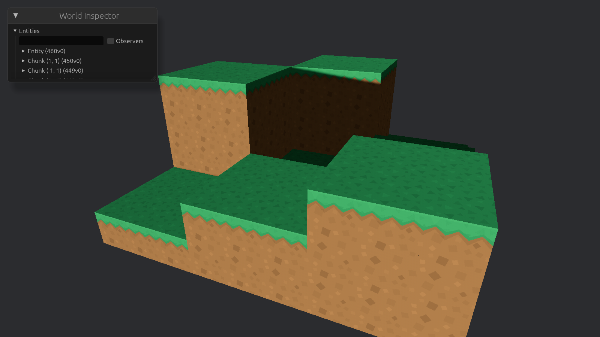
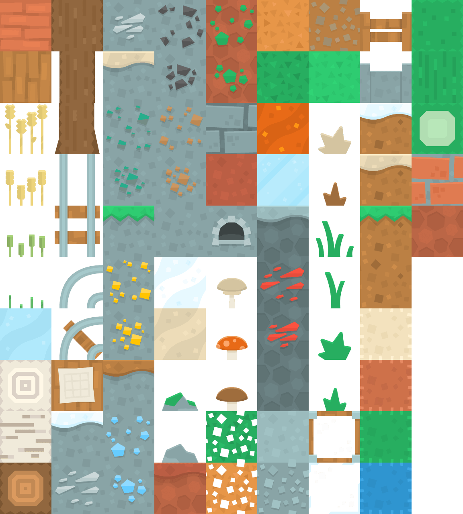

# Multiple voxel types



Now we'll add another voxel type: dirt, how exciting.
In the chunk generation, make only the top layer grass, and the rest dirt.
Rather than simply giving our new voxel type another colour, now we'll start using textures for instead.

You might already know that small sprites are often bundled into a single file.
There are good reasons for this, some of which were also important considerations in the chunk's construction:

- _Memory locality:_ textures are scatter through memory, combining them into a single file puts them together.
- _Batching:_ it is often more efficient to send a bunch of data to the GPU at once, rather than many small pieces.
- _Draw calls:_ although materials _can_ contain multiple textures, it increases the number of draw calls.

In chapter 3 we already learned that meshes use _UV coordinates_ to map parts of a larger texture onto the mesh.
Read that chapter if you need to brush up.

## Using the texture

Find or make a spritesheet with some voxel textures you like, and put it in the `assets` folder in the project root.

For pixel-art textures you'll probably want to enable nearest-neighbour texture filtering.
Otherwise, pixels become blurred.
This is configured by the `ImagePlugin`, which is part of the `DefaultPlugins` bundle.
We can override the image plugin with `set`, passing in a new `ImagePlugin` with the desired settings.
In this case, `ImagePlugin::default_nearest()`.

First, before spawning the world, we need to load the texture and use it to create a new material.
To gain access to the `assets` folder, we need to add a new resource to the system parameters: `AssetServer`.
The asset server allows us to load assets directly from the `assets` folder with `load`.

Replace the `Color` material with a `StandardMaterial`.
Its field `base_color_texture` defines which texture to use.
It expects an `Option`, so wrap the handle returned by the asset server in `Some`.
There's [a bunch of other fields](https://docs.rs/bevy/latest/bevy/prelude/struct.StandardMaterial.html) to adjust how the material looks.
In particular, you might want to play around with `perceptual_roughness` and `reflectance` to voxels less smooth and reflective.

## Getting the right UV coordinates

We need some way to map from coordinates in the spritesheet to UV coordinates for the mesh.
For this we need two things: the total number of rows and columns in the spritesheet, and the coordinate of the tile we want to use.
Create a `TextureAtlas` and `TextureAtlasCoord` to store this information.
UV coordinates are normalized between 0 and 1, so we don't need to know the texture's size in pixels.

Then, create a function to determine the `Vec2` UV coordinates for a given texture atlas and coordinate.
First, determine the normalized width and height of each tile, assuming all tiles are equally sized.
That is, the fraction of space each tile occupies either horizontally or vertically.
For example, in a $2 \times 4$ spritesheet, the corresponding fractions are $0.5$ and $0.25$ respectively.

Using these sizes, we can determine from the given coordinates the **top-left** corner of the requested tile.
(Remember that the y-axis is flipped in UV coordinates.)

From these four variables we can determine the UV coordinates of the four corners.
Remember to use the same order as the vertices.
In my case, that is bottom left, bottom right, top left, top right.

## Directional faces

Grass is unique, because it looks different from the top than it does from the sides or the bottom.
We can't just return the same texture atlas coordinates based only on the voxel type, we also need to know which face of the voxel we're rendering.
Implement a function for `VoxelType` that additionally takes a `Direction` and returns the appropriate `TextureAtlasCoord`.

For the bottom of the grass block we want to use the same texture as the dirt block, which is the second tile in the first row of the spritesheet: `TextureAtlasCoord { x: 1, y: 0 }`.
Add a case for the sides and top, and fill in the appropriate coordinates for any other voxel types you have so far.

We should never reach this function for air, so raise a panic if that ever happens.



## Bevy's built-in TextureAtlas

`TextureAtlas` and `TextureAtlasCoord` were useful for explaining, but we can actually also use Bevy's built-in `TextureAtlas` type.
Perhaps you saw it in the [Bevy introduction](https://bevy.org/news/introducing-bevy).
If you want, you can replace our own types with Bevy's.

Instead of a coordinate, it uses a single index to identify the tile.
We can easily convert our coordinates to an index with `x + y * NUM_ROWS`.

Layouts are stored in `Assets<TextureAtlasLayout>`.
Before spawning the world, we can add a new layout with:

```rust
layouts.add(TextureAtlasLayout::from_grid(
        UVec2::splat(NUM_COLUMNS * NUM_ROWS),
        NUM_COLUMNS,
        NUM_ROWS,
        None,
        None,
    ));
```

Check out [this example](https://bevy.org/examples/ui-user-interface/ui-texture-atlas) and [the documentation](https://docs.rs/bevy/latest/bevy/image/struct.TextureAtlasLayout.html) to figure out how to then use the layout to get the correct UV coordinates for a given tile index.
