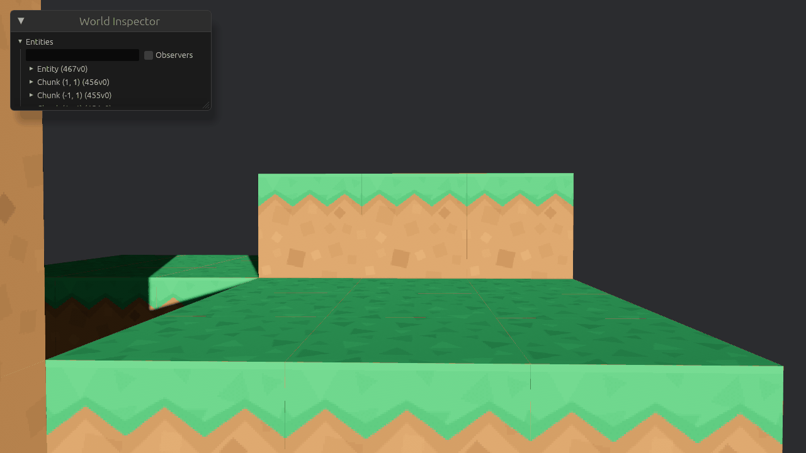

# Creating a player character



Adding a first person player, and especially the necessary physics, might seem daunting.
But it turns out that this is not actually as scary as it sounds in our simple voxel world.

First, we'll need some convenience functions.
For the physics, we'll definitely want to be able to look up arbitrary voxels in the world.
So add a `get_voxel(VoxelCoord) -> Option<VoxelType>` function to the world.
Use the x and z coordinate to determine the coordinate of the voxel, and then adjust the global voxel coordinates to chunk-local coordinates.
We don't place chunks vertically so y can remain unchanged, just check that it is in bounds.
Also add a function `is_solid`, which uses the `get_voxel` function to determine if a voxel is solid or not.

## Multiple game modes

For debugging, it is useful to retain the ability to fly around in spectator mode, so add a `GameMode` enum resource to switch between spectator and survival mode.
Like we did for toggling cursor grabbing, we add a system to switch the game mode when a certain key is pressed.

Also add two boolean function to check whether the current game mode is survival or spectator, which we can use to conditionally run the relevant movement and physics systems.
Remember to use these two functions throughout this chapter when we add the different movement and physics systems.

## Player instance

It's time to replace our mere camera with an actual player instance.
We define two new components, `Player` and `PlayerCamera`.
The player component we will later extend with the player's state.
The player camera component is just a marker component to identify the camera entity belonging to the player.

Modify the function that spawns the camera.

A player also has a certain width and a height, which we define as constants.
I chose $0.6$ and $1.8$ respectively, making the player slightly less than two blocks tall.
For later physics calculations, it makes sense to put the player's origin at their feet, but how do we then position the camera at the player's eyes?
For this, we can nest the camera as a _child_ of the player entity, putting its local y transformation at the chosen eye height.
A child is an entity that is attached to another entity (its _parent_), and its position and rotation are relative to the parent entity.
That is, if an entity is at y position $5$, and its child is locally at y position $2$, that puts them at a global y position of $7$.

We add a child to a spawned entity by chaining the `spawn` operation with a `with_children` operation.
This function takes as an argument a command-like object, which we use just like the main `commands` argument to spawn entities, but these will be children of the parent entity.

Remove the camera component from the player entity, and add the new `Player` component.
Also remove the `looking_at`, since the parent entity no longer controls the camera's vertical rotation.
(If we were to do that, it would be like you were bending your entire body to look up or down, rather than just your neck.)

```text
  C     C
  |      \
  |       \
  O        O

O = origin
C = camera
```

The child instead gets the camera component, alongside the `PlayerCamera` marker and a transform.
Put the transform at the chosen eye height.

### Update the look system

Movement can remain unchanged, but we need to update the look system.
When looking horizontally, we want to rotate the parent player entity, but looking up and down should only rotate the child camera entity.

First, we need to modify the arguments to the function.
We need to distinguish between the player's transform, and the camera's transform.
This is where the two marker components come into play.
For the camera, rather than `Single<&mut Transform, With<Camera3d>>`, we require that it has a `PlayerCamera` component, and that it does not have a `Player` component (`Without<Player>`).
Then, to get the player's transform, we need to ensure that it is disjoint from the camera, so we invert the inclusion requirements of the camera.

Horizontal rotation remains the same, but now apply it to the player rather than the camera.

We'll improve the vertical rotation by clamping it, so the player cannot look all the way up or down.
To clamp the rotation, we need to decompose the camera's rotation into yaw, pitch, and roll (pitch is what we want to clamp).
Looking at [an example](https://bevy.org/examples/camera/camera-orbit), we can achieve this with `to_euler(EulerRot::YXZ)`.

(_It is unclear to me why we specifically use `EulerRot::YXZ` here, but I can't find a description. Please let me know if you know._)

Adjust the pitch by the mouse delta, and clamp the result by the minimum and maximum pitch.
The pitch is in radians, so $\pi / 2$ is the pitch to look straight up.
I use a slightly lower value of $1.4$.

Finally, replace the camera's rotation with a new quaternion, by inverting the decomposition with `Quat::from_euler`.

## Survival player

```rust
fn move_survival
```

Nested run conditions

## Physics

```rust
fn player_physics
```

For physics, we need to separate player input from the physics calculation.
We **must** run the input function every frame, because we might miss inputs.
But the physics simulation is typically run during the `FixedUpdate` schedule.

### Plugins

Implementing collections of data and systems as a plugin is a good way to keep your code organized and to separate concerns.
Turning what we have so far into a plugin is straightforward.
The [documentation](https://bevy.org/learn/quick-start/getting-started/plugins) explains how to do it.
